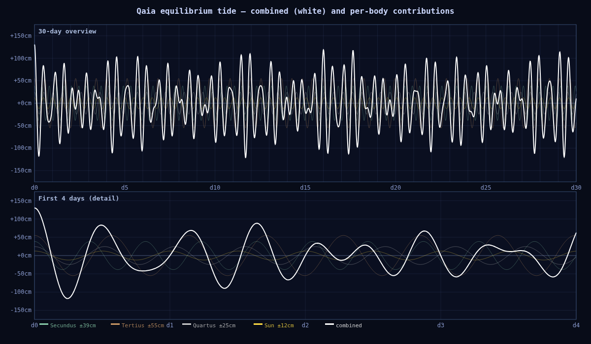

# Qaia Tidal Analysis

Generated from `bodies.js` parameters and the 200-year N-body snapshot (`state_200yr.json`). Re-run `node analysis/tide_sim.mjs` after any changes.

Assumes Qaia has a 24-hour solar day (matching Earth).

### Equilibrium tide model

The [equilibrium tide](https://en.wikipedia.org/wiki/Tide#Tidal_physics) is the theoretical
water-surface shape if the ocean responded instantly to tidal forcing with no friction or
basin dynamics. The half-amplitude of the tidal bulge is:

```
h_eq = (3/4) × (M_moon / M_planet) × (R_planet / a)³ × R_planet
```

Validated against Earth-Moon system (gives ~0.27 m, matching the known theoretical value).

### Primus — static, not oscillating

Primus is geosynchronous: it co-rotates with Qaia and does not sweep across the sky. It
raises a **permanent ~2 cm static tidal bulge** along the Primus–antiprimus axis — a fixed
geographic feature, not a daily cycle. It is excluded from the oscillating tide simulation.

### Simulation method

The tidal height at a fixed surface location is modelled as a sum of cosines, one per body:

```
h(t) = Σ  h_eq_i × cos(2π t / T_tide_i)
```

where `T_tide_i = T_syn_i / 2` is the semi-diurnal tidal period (two bulges per synodic
pass). `t = 0` is set to maximum alignment (all bodies at opposition), so each cosine starts
at its peak. This is the simplest possible model — it ignores ocean basin resonance, friction,
eccentricity-driven amplitude variation, and latitude effects. Real tides on Qaia would differ
substantially in amplitude (resonance can multiply the equilibrium value by ~10×) but the
periods and their interference structure would be the same.

---

## Equilibrium Tide Amplitudes

The equilibrium tide is what you'd get if the ocean could respond instantly. Real tides are
amplified by basin resonance (the Bay of Fundy amplifies Earth's 0.27 m equilibrium to 16 m).

| Body | Tidal period | Equilibrium ± | Notes |
|---|---|---|---|
| Secundus | 9.85 h | ±39 cm | Retrograde, fast |
| Tertius | 13.69 h | ±55 cm | Dominant driver |
| Quartus | 12.43 h | ±25 cm | Same as Earth's Moon |
| Sun | 12.03 h | ±12 cm | |
| **Total (aligned)** | | **±131 cm** | All at opposition simultaneously |

### Why Secundus's tidal period is 9.85 hours

Secundus is retrograde, so its apparent motion across Qaia's sky adds to Qaia's rotation rather
than subtracting. Its synodic period (time between overhead transits) is:

```
T_synodic = T_day × T_orb / (T_orb + T_day) = 24 × 109.68 / (109.68 + 24) = 19.69 h
```

The equilibrium tide has two bulges — one facing the moon, one on the opposite side. A point
on Qaia's surface passes through both bulges per synodic period, so the semi-diurnal tidal
period is half that: **9.85 h**. This gives ~2.4 high tides per Qaia day from Secundus.

Quartus at 12.43 h is nearly identical to Earth's Moon (12.42 h) — as expected, same orbit.

---

## Spring/Neap Beat Periods

Each pair of bodies creates a spring/neap cycle at the beat frequency of their tidal periods:

| Pair | Beat period | Character |
|---|---|---|
| Secundus + Tertius | 1.46 days | Fast amplitude modulation |
| Secundus + Quartus | 1.97 days | |
| Tertius + Quartus | 5.66 days | Medium-term envelope |
| Quartus + Sun | 15.56 days | Familiar fortnightly spring/neap |

The Quartus-Sun beat (~15.6 days) produces a fortnightly spring/neap analogous to Earth's.
Without Primus as a dominant fast driver, the tidal pattern is less extreme than the old
system but still complex — three incommensurate oscillating frequencies from the moons plus
the solar contribution.

---

## 30-Day Simulation

All moons at opposition (maximum alignment) at t=0. Height is equilibrium water level.



Regenerate with `node analysis/tide_sim.mjs`. ASCII table (1-hour resolution):

```
=== 30-day tide simulation (all moons at opposition, t=0) ===
  Overall range: -121 cm to +130 cm
  Max single-cycle swing: 251 cm

  t(h)   tide
     0h    +130cm  ██████████████████████████████
     1h    +112cm  ████████████████████████████
     2h     +64cm  ██████████████████████
     3h      -1cm  ██████████████
     4h     -63cm  ███████
     5h    -106cm  ██
     6h    -117cm  
     7h     -98cm  ███
     8h     -54cm  ████████
     9h      -1cm  ██████████████
    10h     +46cm  ████████████████████
    11h     +76cm  ███████████████████████
    12h     +83cm  ████████████████████████
    13h     +70cm  ███████████████████████
    14h     +44cm  ████████████████████
    15h     +14cm  ████████████████
    16h     -12cm  █████████████
    17h     -30cm  ███████████
    18h     -39cm  ██████████
    19h     -42cm  █████████
    20h     -41cm  ██████████
    21h     -37cm  ██████████
    22h     -30cm  ███████████
    23h     -18cm  ████████████
    24h      +0cm  ██████████████
    25h     +23cm  █████████████████
    26h     +47cm  ████████████████████
    27h     +64cm  ██████████████████████
    28h     +68cm  ███████████████████████
    29h     +54cm  █████████████████████
    30h     +23cm  █████████████████
    31h     -18cm  ████████████
    32h     -58cm  ████████
    33h     -84cm  ████
    34h     -89cm  ████
    35h     -68cm  ██████
    36h     -27cm  ███████████
    37h     +21cm  █████████████████
    38h     +63cm  ██████████████████████
    39h     +86cm  █████████████████████████
    40h     +84cm  ████████████████████████
    41h     +57cm  █████████████████████
    42h     +16cm  ████████████████
    43h     -26cm  ███████████
    44h     -56cm  ████████
    45h     -67cm  ██████
    46h     -56cm  ████████
    47h     -30cm  ███████████
    48h      +0cm  ██████████████
    49h     +24cm  █████████████████
    50h     +34cm  ██████████████████
    51h     +29cm  ██████████████████
    52h     +14cm  ████████████████
    53h      -2cm  ██████████████
    54h     -12cm  █████████████
    55h     -11cm  █████████████
    56h      -0cm  ██████████████
    57h     +15cm  ████████████████
    58h     +27cm  ██████████████████
    59h     +27cm  ██████████████████
    60h     +14cm  ████████████████
    61h      -9cm  █████████████
    62h     -34cm  ██████████
    63h     -51cm  ████████
    64h     -54cm  ████████
    65h     -38cm  ██████████
    66h      -8cm  █████████████
    67h     +27cm  ██████████████████
    68h     +55cm  █████████████████████
    69h     +67cm  ██████████████████████
    70h     +59cm  ██████████████████████
    71h     +34cm  ███████████████████
    72h      -0cm  ██████████████
    73h     -33cm  ███████████
    74h     -54cm  ████████
    75h     -58cm  ████████
    76h     -46cm  █████████
    77h     -23cm  ████████████
    78h      +1cm  ███████████████
    79h     +20cm  █████████████████
    80h     +29cm  ██████████████████
    81h     +28cm  ██████████████████
    82h     +21cm  █████████████████
    83h     +14cm  ████████████████
    84h     +11cm  ████████████████
    85h     +12cm  ████████████████
    86h     +13cm  ████████████████
    87h     +12cm  ████████████████
    88h      +3cm  ███████████████
    89h     -14cm  █████████████
    90h     -35cm  ██████████
    91h     -52cm  ████████
    92h     -58cm  ███████
    93h     -47cm  █████████
    94h     -18cm  ████████████
    95h     +23cm  █████████████████
    96h     +63cm  ██████████████████████
    97h     +89cm  █████████████████████████
    98h     +92cm  █████████████████████████
    99h     +68cm  ██████████████████████
   100h     +21cm  █████████████████
   101h     -34cm  ██████████
   102h     -82cm  █████
   103h    -108cm  █
   104h    -104cm  ██
   105h     -71cm  ██████
   106h     -18cm  ████████████
   107h     +39cm  ███████████████████
   108h     +83cm  ████████████████████████
   109h    +103cm  ███████████████████████████
   110h     +93cm  ██████████████████████████
   111h     +60cm  ██████████████████████
   112h     +15cm  ████████████████
   113h     -29cm  ███████████
   114h     -61cm  ███████
   115h     -73cm  ██████
   116h     -66cm  ███████
   117h     -47cm  █████████
   118h     -21cm  ████████████
   119h      +2cm  ███████████████
   120h     +19cm  █████████████████
   121h     +29cm  ██████████████████
   122h     +35cm  ███████████████████
   123h     +38cm  ███████████████████
   124h     +39cm  ███████████████████
   125h     +38cm  ███████████████████
   126h     +31cm  ██████████████████
   127h     +15cm  ████████████████
   128h      -9cm  █████████████
   129h     -38cm  ██████████
   130h     -64cm  ███████
   131h     -77cm  █████
   132h     -72cm  ██████
   133h     -46cm  █████████
   134h      -3cm  ██████████████
   135h     +45cm  ████████████████████
   136h     +84cm  █████████████████████████
   137h    +103cm  ███████████████████████████
   138h     +94cm  ██████████████████████████
   139h     +58cm  █████████████████████
   140h      +5cm  ███████████████
   141h     -50cm  ████████
   142h     -91cm  ████
   143h    -106cm  ██
   144h     -91cm  ████
   145h     -52cm  ████████
   146h      -2cm  ██████████████
   147h     +45cm  ████████████████████
   148h     +76cm  ███████████████████████
   149h     +83cm  ████████████████████████
   150h     +67cm  ██████████████████████
   151h     +37cm  ███████████████████
   152h      +3cm  ███████████████
   153h     -25cm  ███████████
   154h     -40cm  ██████████
   155h     -42cm  █████████
   156h     -34cm  ██████████
   157h     -23cm  ████████████
   158h     -14cm  █████████████
   159h      -9cm  █████████████
   160h      -7cm  ██████████████
   161h      -4cm  ██████████████
   162h      +4cm  ███████████████
   163h     +17cm  █████████████████
   164h     +34cm  ██████████████████
   165h     +48cm  ████████████████████
   166h     +52cm  █████████████████████
   167h     +40cm  ███████████████████
   168h     +14cm  ████████████████
   169h     -21cm  ████████████
   170h     -55cm  ████████
   171h     -78cm  █████
   172h     -79cm  █████
   173h     -58cm  ████████
   174h     -18cm  ████████████
   175h     +29cm  ██████████████████
   176h     +68cm  ███████████████████████
   177h     +88cm  █████████████████████████
   178h     +82cm  ████████████████████████
   179h     +54cm  █████████████████████
   180h     +12cm  ████████████████
   181h     -31cm  ███████████
   182h     -62cm  ███████
   183h     -73cm  ██████
   184h     -62cm  ███████
   185h     -36cm  ██████████
   186h      -5cm  ██████████████
   187h     +22cm  █████████████████
   188h     +36cm  ███████████████████
   189h     +37cm  ███████████████████
   190h     +28cm  ██████████████████
   191h     +15cm  ████████████████
   192h      +4cm  ███████████████
   193h      +1cm  ███████████████
   194h      +3cm  ███████████████
   195h      +7cm  ███████████████
   196h      +8cm  ███████████████
   197h      +0cm  ██████████████
   198h     -14cm  █████████████
   199h     -32cm  ███████████
   200h     -45cm  █████████
   201h     -46cm  █████████
   202h     -32cm  ███████████
   203h      -4cm  ██████████████
   204h     +30cm  ██████████████████
   205h     +59cm  █████████████████████
   206h     +73cm  ███████████████████████
   207h     +66cm  ██████████████████████
   208h     +39cm  ███████████████████
   209h      -1cm  ██████████████
   210h     -42cm  █████████
   211h     -71cm  ██████
   212h     -79cm  █████
   213h     -63cm  ███████
   214h     -31cm  ███████████
   215h      +8cm  ███████████████
   216h     +42cm  ███████████████████
   217h     +60cm  ██████████████████████
   218h     +59cm  █████████████████████
   219h     +42cm  ███████████████████
   220h     +16cm  ████████████████
   221h      -8cm  █████████████
   222h     -24cm  ████████████
   223h     -27cm  ███████████
   224h     -21cm  ████████████
   225h     -12cm  █████████████
   226h      -4cm  ██████████████
   227h      -4cm  ██████████████
   228h     -10cm  █████████████
   229h     -18cm  ████████████
   230h     -21cm  ████████████
   231h     -15cm  █████████████
   232h      +1cm  ███████████████
   233h     +25cm  █████████████████
   234h     +48cm  ████████████████████
   235h     +60cm  ██████████████████████
   236h     +55cm  █████████████████████
   237h     +31cm  ██████████████████
   238h      -7cm  ██████████████
   239h     -47cm  █████████
   240h     -78cm  █████
   241h     -87cm  ████
   242h     -71cm  ██████
   243h     -34cm  ██████████
   244h     +14cm  ████████████████
   245h     +59cm  █████████████████████
   246h     +87cm  █████████████████████████
   247h     +90cm  █████████████████████████
   248h     +68cm  ███████████████████████
   249h     +29cm  ██████████████████
   250h     -15cm  █████████████
   251h     -51cm  ████████
   252h     -70cm  ██████
   253h     -70cm  ██████
   254h     -52cm  ████████
   255h     -26cm  ███████████
   256h      +1cm  ███████████████
   257h     +21cm  █████████████████
   258h     +32cm  ██████████████████
   259h     +35cm  ███████████████████
   260h     +34cm  ██████████████████
   261h     +31cm  ██████████████████
   262h     +28cm  ██████████████████
   263h     +24cm  █████████████████
   264h     +16cm  ████████████████
   265h      +0cm  ██████████████
   266h     -22cm  ████████████
   267h     -46cm  █████████
   268h     -66cm  ███████
   269h     -72cm  ██████
   270h     -58cm  ███████
   271h     -26cm  ███████████
   272h     +19cm  █████████████████
   273h     +66cm  ██████████████████████
   274h     +99cm  ██████████████████████████
   275h    +107cm  ███████████████████████████
   276h     +85cm  █████████████████████████
   277h     +37cm  ███████████████████
   278h     -23cm  ████████████
   279h     -80cm  █████
   280h    -115cm  █
   281h    -119cm  
   282h     -89cm  ████
   283h     -36cm  ██████████
   284h     +26cm  █████████████████
   285h     +78cm  ████████████████████████
   286h    +107cm  ███████████████████████████
   287h    +105cm  ███████████████████████████
   288h     +77cm  ████████████████████████
   289h     +31cm  ██████████████████
   290h     -18cm  ████████████
   291h     -56cm  ████████
   292h     -75cm  █████
   293h     -74cm  ██████
   294h     -56cm  ████████
   295h     -30cm  ███████████
   296h      -4cm  ██████████████
   297h     +16cm  ████████████████
   298h     +29cm  ██████████████████
   299h     +36cm  ███████████████████
   300h     +39cm  ███████████████████
   301h     +39cm  ███████████████████
   302h     +37cm  ███████████████████
   303h     +30cm  ██████████████████
   304h     +16cm  ████████████████
   305h      -5cm  ██████████████
   306h     -31cm  ███████████
   307h     -55cm  ████████
   308h     -70cm  ██████
   309h     -68cm  ██████
   310h     -47cm  █████████
   311h     -10cm  █████████████
   312h     +33cm  ██████████████████
   313h     +71cm  ███████████████████████
   314h     +91cm  █████████████████████████
   315h     +86cm  █████████████████████████
   316h     +57cm  █████████████████████
   317h     +10cm  ████████████████
   318h     -39cm  ██████████
   319h     -77cm  █████
   320h     -91cm  ████
   321h     -79cm  █████
   322h     -45cm  █████████
   323h      +0cm  ██████████████
   324h     +41cm  ███████████████████
   325h     +65cm  ██████████████████████
   326h     +68cm  ███████████████████████
   327h     +50cm  ████████████████████
   328h     +20cm  █████████████████
   329h     -10cm  █████████████
   330h     -31cm  ███████████
   331h     -37cm  ██████████
   332h     -28cm  ███████████
   333h     -11cm  █████████████
   334h      +5cm  ███████████████
   335h     +13cm  ████████████████
   336h     +10cm  ████████████████
   337h      -2cm  ██████████████
   338h     -16cm  ████████████
   339h     -25cm  ███████████
   340h     -22cm  ████████████
   341h      -6cm  ██████████████
   342h     +16cm  ████████████████
   343h     +38cm  ███████████████████
   344h     +50cm  ████████████████████
   345h     +45cm  ████████████████████
   346h     +25cm  █████████████████
   347h      -5cm  ██████████████
   348h     -36cm  ██████████
   349h     -57cm  ████████
   350h     -61cm  ███████
   351h     -47cm  █████████
   352h     -19cm  ████████████
   353h     +13cm  ████████████████
   354h     +39cm  ███████████████████
   355h     +52cm  █████████████████████
   356h     +49cm  ████████████████████
   357h     +33cm  ██████████████████
   358h     +12cm  ████████████████
   359h      -8cm  ██████████████
   360h     -20cm  ████████████
   361h     -23cm  ████████████
   362h     -19cm  ████████████
   363h     -14cm  █████████████
   364h     -11cm  █████████████
   365h     -13cm  █████████████
   366h     -18cm  ████████████
   367h     -21cm  ████████████
   368h     -16cm  ████████████
   369h      -2cm  ██████████████
   370h     +21cm  █████████████████
   371h     +46cm  ████████████████████
   372h     +63cm  ██████████████████████
   373h     +64cm  ██████████████████████
   374h     +45cm  ████████████████████
   375h      +8cm  ███████████████
   376h     -38cm  ██████████
   377h     -79cm  █████
   378h    -101cm  ██
   379h     -95cm  ███
   380h     -60cm  ███████
   381h      -5cm  ██████████████
   382h     +54cm  █████████████████████
   383h    +100cm  ██████████████████████████
   384h    +119cm  █████████████████████████████
   385h    +104cm  ███████████████████████████
   386h     +61cm  ██████████████████████
   387h      +1cm  ███████████████
   388h     -58cm  ████████
   389h     -99cm  ███
   390h    -111cm  █
   391h     -94cm  ███
   392h     -54cm  ████████
   393h      -4cm  ██████████████
   394h     +42cm  ███████████████████
   395h     +72cm  ███████████████████████
   396h     +82cm  ████████████████████████
   397h     +72cm  ███████████████████████
   398h     +49cm  ████████████████████
   399h     +21cm  █████████████████
   400h      -7cm  ██████████████
   401h     -28cm  ███████████
   402h     -42cm  █████████
   403h     -50cm  ████████
   404h     -52cm  ████████
   405h     -49cm  █████████
   406h     -39cm  ██████████
   407h     -21cm  ████████████
   408h      +5cm  ███████████████
   409h     +35cm  ███████████████████
   410h     +64cm  ██████████████████████
   411h     +83cm  ████████████████████████
   412h     +83cm  ████████████████████████
   413h     +61cm  ██████████████████████
   414h     +20cm  █████████████████
   415h     -32cm  ███████████
   416h     -79cm  █████
   417h    -108cm  ██
   418h    -109cm  █
   419h     -80cm  █████
   420h     -27cm  ███████████
   421h     +34cm  ███████████████████
   422h     +87cm  █████████████████████████
   423h    +115cm  ████████████████████████████
   424h    +111cm  ████████████████████████████
   425h     +76cm  ████████████████████████
   426h     +22cm  █████████████████
   427h     -35cm  ██████████
   428h     -79cm  █████
   429h     -97cm  ███
   430h     -88cm  ████
   431h     -56cm  ████████
   432h     -14cm  █████████████
   433h     +26cm  ██████████████████
   434h     +52cm  █████████████████████
   435h     +59cm  ██████████████████████
   436h     +50cm  ████████████████████
   437h     +31cm  ██████████████████
   438h     +10cm  ████████████████
   439h      -5cm  ██████████████
   440h     -12cm  █████████████
   441h     -12cm  █████████████
   442h     -10cm  █████████████
   443h     -11cm  █████████████
   444h     -16cm  █████████████
   445h     -24cm  ████████████
   446h     -31cm  ███████████
   447h     -30cm  ███████████
   448h     -19cm  ████████████
   449h      +3cm  ███████████████
   450h     +28cm  ██████████████████
   451h     +51cm  ████████████████████
   452h     +61cm  ██████████████████████
   453h     +53cm  █████████████████████
   454h     +29cm  ██████████████████
   455h      -5cm  ██████████████
   456h     -40cm  ██████████
   457h     -63cm  ███████
   458h     -68cm  ██████
   459h     -53cm  ████████
   460h     -23cm  ████████████
   461h     +12cm  ████████████████
   462h     +41cm  ███████████████████
   463h     +54cm  █████████████████████
   464h     +50cm  ████████████████████
   465h     +32cm  ██████████████████
   466h      +8cm  ███████████████
   467h     -14cm  █████████████
   468h     -25cm  ███████████
   469h     -24cm  ████████████
   470h     -14cm  █████████████
   471h      -1cm  ██████████████
   472h      +7cm  ███████████████
   473h      +5cm  ███████████████
   474h      -5cm  ██████████████
   475h     -18cm  ████████████
   476h     -28cm  ███████████
   477h     -27cm  ███████████
   478h     -13cm  █████████████
   479h     +13cm  ████████████████
   480h     +40cm  ███████████████████
   481h     +60cm  ██████████████████████
   482h     +62cm  ██████████████████████
   483h     +44cm  ████████████████████
   484h      +9cm  ███████████████
   485h     -33cm  ██████████
   486h     -68cm  ██████
   487h     -85cm  ████
   488h     -77cm  █████
   489h     -46cm  █████████
   490h      -0cm  ██████████████
   491h     +45cm  ████████████████████
   492h     +77cm  ████████████████████████
   493h     +87cm  █████████████████████████
   494h     +72cm  ███████████████████████
   495h     +38cm  ███████████████████
   496h      -3cm  ██████████████
   497h     -40cm  ██████████
   498h     -62cm  ███████
   499h     -65cm  ███████
   500h     -52cm  ████████
   501h     -29cm  ███████████
   502h      -5cm  ██████████████
   503h     +14cm  ████████████████
   504h     +25cm  █████████████████
   505h     +28cm  ██████████████████
   506h     +27cm  ██████████████████
   507h     +27cm  ██████████████████
   508h     +27cm  ██████████████████
   509h     +26cm  ██████████████████
   510h     +22cm  █████████████████
   511h     +11cm  ████████████████
   512h      -9cm  █████████████
   513h     -34cm  ██████████
   514h     -57cm  ████████
   515h     -69cm  ██████
   516h     -64cm  ███████
   517h     -39cm  ██████████
   518h      +1cm  ███████████████
   519h     +47cm  ████████████████████
   520h     +84cm  ████████████████████████
   521h    +100cm  ██████████████████████████
   522h     +89cm  █████████████████████████
   523h     +51cm  █████████████████████
   524h      -2cm  ██████████████
   525h     -57cm  ████████
   526h     -96cm  ███
   527h    -108cm  ██
   528h     -90cm  ████
   529h     -48cm  █████████
   530h      +5cm  ███████████████
   531h     +54cm  █████████████████████
   532h     +84cm  █████████████████████████
   533h     +90cm  █████████████████████████
   534h     +72cm  ███████████████████████
   535h     +38cm  ███████████████████
   536h      -0cm  ██████████████
   537h     -32cm  ███████████
   538h     -50cm  ████████
   539h     -53cm  ████████
   540h     -44cm  █████████
   541h     -30cm  ███████████
   542h     -16cm  █████████████
   543h      -5cm  ██████████████
   544h      +2cm  ███████████████
   545h      +9cm  ████████████████
   546h     +19cm  █████████████████
   547h     +30cm  ██████████████████
   548h     +43cm  ████████████████████
   549h     +49cm  ████████████████████
   550h     +45cm  ████████████████████
   551h     +28cm  ██████████████████
   552h      -3cm  ██████████████
   553h     -39cm  ██████████
   554h     -70cm  ██████
   555h     -86cm  ████
   556h     -79cm  █████
   557h     -48cm  █████████
   558h      -1cm  ██████████████
   559h     +49cm  ████████████████████
   560h     +88cm  █████████████████████████
   561h    +102cm  ███████████████████████████
   562h     +89cm  █████████████████████████
   563h     +50cm  ████████████████████
   564h      -2cm  ██████████████
   565h     -51cm  ████████
   566h     -85cm  ████
   567h     -93cm  ███
   568h     -76cm  █████
   569h     -40cm  ██████████
   570h      +3cm  ███████████████
   571h     +39cm  ███████████████████
   572h     +59cm  ██████████████████████
   573h     +61cm  ██████████████████████
   574h     +48cm  ████████████████████
   575h     +27cm  ██████████████████
   576h      +6cm  ███████████████
   577h     -10cm  █████████████
   578h     -17cm  ████████████
   579h     -18cm  ████████████
   580h     -18cm  ████████████
   581h     -20cm  ████████████
   582h     -25cm  ████████████
   583h     -29cm  ███████████
   584h     -30cm  ███████████
   585h     -21cm  ████████████
   586h      -3cm  ██████████████
   587h     +23cm  █████████████████
   588h     +49cm  ████████████████████
   589h     +66cm  ██████████████████████
   590h     +66cm  ██████████████████████
   591h     +46cm  ████████████████████
   592h     +10cm  ████████████████
   593h     -32cm  ███████████
   594h     -68cm  ██████
   595h     -86cm  ████
   596h     -80cm  █████
   597h     -50cm  ████████
   598h      -6cm  ██████████████
   599h     +40cm  ███████████████████
   600h     +73cm  ███████████████████████
   601h     +83cm  ████████████████████████
   602h     +70cm  ███████████████████████
   603h     +37cm  ███████████████████
   604h      -3cm  ██████████████
   605h     -37cm  ██████████
   606h     -56cm  ████████
   607h     -56cm  ████████
   608h     -41cm  ██████████
   609h     -16cm  ████████████
   610h      +6cm  ███████████████
   611h     +20cm  █████████████████
   612h     +22cm  █████████████████
   613h     +15cm  ████████████████
   614h      +5cm  ███████████████
   615h      -1cm  ██████████████
   616h      +0cm  ██████████████
   617h      +9cm  ████████████████
   618h     +21cm  █████████████████
   619h     +28cm  ██████████████████
   620h     +25cm  █████████████████
   621h      +9cm  ████████████████
   622h     -15cm  █████████████
   623h     -40cm  ██████████
   624h     -56cm  ████████
   625h     -57cm  ████████
   626h     -39cm  ██████████
   627h      -7cm  ██████████████
   628h     +30cm  ██████████████████
   629h     +60cm  ██████████████████████
   630h     +73cm  ███████████████████████
   631h     +65cm  ██████████████████████
   632h     +38cm  ███████████████████
   633h      +0cm  ██████████████
   634h     -35cm  ██████████
   635h     -59cm  ███████
   636h     -64cm  ███████
   637h     -51cm  ████████
   638h     -26cm  ███████████
   639h      +2cm  ███████████████
   640h     +24cm  █████████████████
   641h     +34cm  ██████████████████
   642h     +33cm  ██████████████████
   643h     +24cm  █████████████████
   644h     +14cm  ████████████████
   645h      +7cm  ███████████████
   646h      +6cm  ███████████████
   647h      +8cm  ███████████████
   648h     +10cm  ████████████████
   649h      +5cm  ███████████████
   650h      -9cm  █████████████
   651h     -28cm  ███████████
   652h     -46cm  █████████
   653h     -56cm  ████████
   654h     -49cm  █████████
   655h     -25cm  ███████████
   656h     +13cm  ████████████████
   657h     +54cm  █████████████████████
   658h     +84cm  ████████████████████████
   659h     +93cm  ██████████████████████████
   660h     +75cm  ███████████████████████
   661h     +33cm  ██████████████████
   662h     -22cm  ████████████
   663h     -73cm  ██████
   664h    -106cm  ██
   665h    -109cm  █
   666h     -82cm  █████
   667h     -32cm  ███████████
   668h     +26cm  ██████████████████
   669h     +76cm  ███████████████████████
   670h    +103cm  ███████████████████████████
   671h    +101cm  ███████████████████████████
   672h     +74cm  ███████████████████████
   673h     +30cm  ██████████████████
   674h     -18cm  ████████████
   675h     -55cm  ████████
   676h     -75cm  █████
   677h     -75cm  █████
   678h     -59cm  ███████
   679h     -34cm  ██████████
   680h      -8cm  ██████████████
   681h     +15cm  ████████████████
   682h     +31cm  ██████████████████
   683h     +42cm  ███████████████████
   684h     +48cm  ████████████████████
   685h     +49cm  ████████████████████
   686h     +46cm  ████████████████████
   687h     +34cm  ███████████████████
   688h     +14cm  ████████████████
   689h     -14cm  █████████████
   690h     -45cm  █████████
   691h     -72cm  ██████
   692h     -85cm  ████
   693h     -78cm  █████
   694h     -48cm  █████████
   695h      -2cm  ██████████████
   696h     +51cm  ████████████████████
   697h     +94cm  ██████████████████████████
   698h    +114cm  ████████████████████████████
   699h    +103cm  ███████████████████████████
   700h     +63cm  ██████████████████████
   701h      +4cm  ███████████████
   702h     -57cm  ████████
   703h    -103cm  ██
   704h    -120cm  
   705h    -103cm  ██
   706h     -59cm  ███████
   707h      +0cm  ██████████████
   708h     +56cm  █████████████████████
   709h     +92cm  █████████████████████████
   710h    +101cm  ██████████████████████████
   711h     +81cm  ████████████████████████
   712h     +43cm  ████████████████████
   713h      -2cm  ██████████████
   714h     -40cm  ██████████
   715h     -61cm  ███████
   716h     -62cm  ███████
   717h     -48cm  █████████
   718h     -26cm  ███████████
   719h      -4cm  ██████████████
   720h     +11cm  ████████████████
```

---

## Worldbuilding Implications

**Pattern complexity**: Earth has one dominant tidal frequency (M2, 12.42 h) with weak
overtones — sailors can learn to predict tides by watching the Moon. Qaia has four
comparable forcing frequencies (9.85h, 13.69h, 12.43h, 12.03h); accurate prediction
requires written tidal tables, though the tides are far less violent than if Primus were
oscillating.

**Primus's geosynchronous effect**: Instead of contributing a fast, large oscillating tide,
Primus raises only a small (~2 cm) permanent bulge on the sub-Primus side of Qaia. This
is a permanent feature of sea level geography — the ocean is very slightly deeper beneath
Primus.

**Tidal range**: The maximum equilibrium range (all aligned) is ~2.5 m. With ocean basin
resonance this could be amplified to potentially 10–30 m in narrow bays — comparable to
Earth's most extreme tidal locations but not catastrophically beyond them.

**Retrograde visual cues**: A coastal observer can watch Secundus rising in the west and
estimate tidal timing. Tertius (prograde, ~8-day period) is the dominant tidal driver;
when Tertius and Secundus are in the same part of the sky, expect amplified tides.

**Long-term**: Secundus (retrograde) spirals inward over geological time due to tidal
friction, slowly increasing its tidal contribution. Tertius and Quartus (prograde) recede,
like Earth's Moon. Primus is magically anchored — no migration.

---

## Location-Specific Tides (ports)

Everything above is a global, location-free model. For tide tables at actual places, open
**[Port tides](tides.html)** (`tides.html`): pick a port and date for a tide table and charts,
plus a year overview of every port, computed live in the browser. The model is `tides.js`,
ports are in `ports.js` and their fitted responses in `port_response.js`. Two scripts give
the same results on the command line:

```bash
node analysis/tide_table.mjs qaringil 2253-03-01 7      # high/low water table, local time
node analysis/port_report.mjs all 2253-02-01 365 --plot  # partial tides, ranges + 14-day plots
```

### Method

1. **Equilibrium forcing from the simulated geometry.** Each body's tide at a site is
   `K · P₂(cos z)` with `K = (M/M_Qaia)(R/r)³R`, split exactly into long-period, diurnal
   (`¾ sin2φ sin2δ cos H`) and semidiurnal (`¾ cos²φ cos²δ cos 2H`) species. The declination
   δ, hour angle H and distance r come straight from the N-body sim, so eccentricity,
   declination cycles and orbital precession (the "nodal corrections" of Earth tide tables)
   are built in.
2. **Ocean response: the response method** (Munk & Cartwright 1966), fitted to the
   [2-D model](#2-d-tide-model-the-qamis-map). Per site, the water level is a fixed linear
   filter of the local forcing:

       h(t) = c + g·C₀(t) + Σ_s Σ_ℓ [ a_sℓ·C_s(t − ℓ) + b_sℓ·S_s(t − ℓ) ]  +  Σ_j q_j·N_j

   C_s and S_s are the in-phase and quadrature (cos mH ↔ sin mH) equilibrium tides of
   species s, summed over the moons and the Sun, at lags ℓ = 0, 6, …, 120 h. N_j are a few
   products of the fitted once- and twice-daily parts (`NL_TERMS`), the kind of distortion
   quadratic bottom friction causes. 86 linear and 20 non-linear weights per site.

   For any one moon the whole forcing field of a species is a fixed spatial pattern times
   one complex number, so the local forcing carries everything the 2-D model sees. The
   filter therefore stands in for the whole sea, and because it acts on the actual forcing it
   follows the orbits as they evolve. A fixed set of harmonic constituents would not, and Qaia
   would need dozens of them.

   `analysis/fit_port_response.mjs` runs the 2-D model over four 90-day windows years apart
   (2253–2263, so it sees the orbits in several configurations) and fits each site by least
   squares. It then scores the fit on two windows it never saw (2261, 2270).

   | Site | Signal RMS | Error, fitted windows | Error, unseen windows | Worst miss |
   |---|---|---|---|---|
   | Qaringil | 79 cm | 6.8 cm | 7.9 cm | 38 cm |
   | Kard | 48 cm | 4.8 cm | 5.4 cm | 24 cm |
   | Jia | 75 cm | 8.5 cm | 8.8 cm | 37 cm |
   | Templado | 71 cm | 7.0 cm | 7.2 cm | 36 cm |
   | Qis | 121 cm | 9.6 cm | 10.5 cm | 33 cm |
   | Freeport | 139 cm | 10.3 cm | 10.5 cm | 55 cm |
   | Bridge current | 3.6 m/s | | 0.26 m/s | 1.6 m/s |

   So high and low water times and heights match the 2-D model to a few percent. What's left
   is mostly twice-daily misfit spread through the wide band (Secundus's eccentric sidebands
   reach ~2.9 cycles a day) plus some friction overtides. Lags past 120 h don't help, the
   non-linear terms take the worst misses down by a quarter (Freeport 73 → 55 cm), and the
   errors are the same with a 12-day spin-up of the 2-D model, so they aren't start-up
   transients.

   Partial tides (one body, one species; the "What drives each port" chart) use the linear
   part alone. **Changing the bathymetry, the mask, a port's position or a moon means
   refitting** (`node analysis/fit_port_response.mjs --write`, ~3 min on the laptop GPU;
   `--cache DIR` keeps the 2-D runs for re-fitting). Each port's tide is now tuned through
   the bathymetry in `ocean_grid.js`, not per port.

### The Central Sea

From the map, the Central Sea is a ~1000 km sea closed at the north by the wizard-built
isthmus (with one gap) and open to the ocean in the southwest. Geometrically it is the
Adriatic, with Qaringil in Venice's spot at the head. In the 2-D model it is ~200 m deep. Down
its middle (the "Along the Central Sea" chart, typical amplitudes over 120 days from 1 Feb
2253):

| km from Qaringil | 0 | 200 | 280 | 400 | 600 | 800 | 870 | 1000 |
|---|---|---|---|---|---|---|---|---|
| once-daily | 75 cm | 68 | 52 | 38 | 27 | 31 | 53 | 55 |
| twice-daily | 39 cm | 31 | 9 | 32 | 31 | 36 | 77 | 76 |

- **Qaringil** (head): once-daily tides pile up at the closed end. It's the most once-daily
  port (F = 1.4): about half the days have one high water. Median daily range 1.8 m.
- The twice-daily tide nearly vanishes ~280 km down the sea, among the northern islands.
  With Coriolis it's a rotating amphidrome rather than a 1-D node, and Kard, mid-sea, is
  clear of it.
- **Kard** (mid-sea, Qamis shore): the smallest tides on the map, median 1.3 m, mostly twice
  daily (F = 0.7), led by Tertius.
- **Jia** and **Templado** (the mouth): out of the sea's shelter, the twice-daily tide
  doubles. Secundus and Tertius are about equal there, so a third of days have three high
  waters. Median ~2.3–2.4 m.

Qaia's moons put tidal forcing all through 9.8–27.3 h, so no depth avoids resonance entirely.
A Venice-like *microtidal* Qaringil (< 1 m) isn't reachable with an open sea: Qaia's
equilibrium tide is 2–3× Earth's. That would need extra sheltering, such as a lagoon behind
narrow inlets (not modelled).

### Current ports (1 year from 1 Feb 2253, heights relative to mean sea level)

| Port | Character | Largest partial tides | Median / spring daily range | Highs per day |
|---|---|---|---|---|
| Qaringil | Mixed, on the edge of diurnal (F = 1.4) | Tertius D 40, Tertius SD 36, Quartus D 19 cm | 1.8 / 2.5 m | 1: 49%, 2: 48% |
| Kard | Mixed, mainly semidiurnal (F = 0.7) | Tertius SD 37, Tertius D 25, Quartus SD 14 cm | 1.3 / 1.9 m | 1: 21%, 2: 74% |
| Jia | Mixed, mainly semidiurnal (F = 0.7) | Secundus SD 32, Tertius SD 30, Tertius D 29 cm | 2.4 / 3.5 m | 2: 57%, 3+: 35% |
| Templado | Mixed, mainly semidiurnal (F = 0.6) | Secundus SD 41, Tertius SD 36, Tertius D 27 cm | 2.3 / 3.4 m | 2: 59%, 3+: 31% |
| Qis (river mouth) | Semidiurnal, Secundus-dominated (F = 0.19) | Secundus SD 150, Tertius SD 61, Quartus SD 36 cm | 4.3 / 5.7 m | 2: 54%, 3+: 45% |
| Freeport | Semidiurnal (F = 0.24) | Secundus SD 133, Tertius SD 104, Quartus SD 54 cm | 4.9 / 6.5 m | 2: 57%, 3+: 39% |

F is the form number, Σ diurnal / Σ semidiurnal partial-tide amplitudes. Spring range is
the 90th percentile of the daily range. Qis's shelf resonates near Secundus's 9.9 h, so Qis is
Secundus-dominated. Retune the Qis shelf in `ocean_grid.js` (wider or shallower) if it should
be Tertius-dominated. The tides are those of an invented bathymetry; see `ports.js` for each
port's map coordinates (~1.72 km per map pixel, anchored on Qaringil and Qama).

**Not modelled:** storm surge, river flow, and anything at harbour scale (the 2-D grid is
~10 km). The fitted model doesn't give currents, except through the bridge gap.

### The isthmus, the bridges and Qaringil

Qaringil is on a tiny island just south of the west side of the isthmus, at the north end
(head) of the Central Sea; `docket/map-nice-marked.jpeg` marks it with a dot. The isthmus is partly
wizard-made: the causeway and its bridges span what used to be open water. So the Central Sea
was once a strait to the sea in the north.

In the 2-D model the isthmus is a wall with **one gap under the Great Western Bridge**, sized
like the Golden Gate (1.6 km wide, 60 m deep, 5 km long; see the 2-D model below). It's far too
small to change the Central Sea's tide much: the head stays effectively closed. It still runs a
ferocious current, because the levels on either side differ by up to ~2.8 m:

- Peak current about **6 m/s (12 knots)** either way over a year, median speed 3 m/s, and
  ~2 slack waters a day. That's in the class of the Strait of Messina (Charybdis) or
  Saltstraumen. Slack water is the only safe time to pass.
- The Port tides page rebuilds the current from the fitted levels at the gap's two ends with
  the 2-D model's own strait equation (`tides.js` `gapCurrent`). It matches the 2-D model's
  current to 0.26 m/s RMS.

Worldbuilding hooks: bridge pilots and slack-water tables as a Qaringil monopoly; tide
mills; whirlpools at the gap mouths. Also, "the tides rose when the wizards closed the
strait": with the strait open, Qaringil was not at a closed head and its tides would have
been smaller.

## 2-D Tide Model (the Qamis map)

A depth-averaged shallow-water model on the flat-sea map (`ocean_grid.js`, `ocean2d.js`),
shown live on the **Tide map** page (`tidemap.html`). It has the real coastline, Coriolis,
and the open ocean around the map, so it produces amphidromes, coastal amplification and
currents on its own. The port tide tables are fitted to it (see the method above).

### Grid and bathymetry

- **Mask**: `docket/tools/sea_mask.py` → `ocean_mask.json`, 6 map px ≈ 10.3 km cells. The map
  is treated as flat with square pixels (1.71 km/px); lat/lon (for forcing and Coriolis) use
  the `ports.js` conversion. Lettering in the water is forced to sea; the isthmus is drawn in
  as a wall (its thin causeway otherwise breaks into a 10 km channel).
- **Domain**: the map plus ~300 km of extra ocean on every side, so the open boundaries sit
  in deep water. The western landmass continues off-map, its north coast angled steeply and
  its south coast shallowly (`OCEAN.westLand`).
- **Depth is invented** from distance to the coast: a shelf (15 m at the coast →
  `shelfDepth` at `shelfWidth`), then an S-shaped slope to `deep` over `slopeWidth`. Defaults
  140 m / 80 km / 120 km / 3000 m. Regions override the four numbers near an anchor point,
  blended by `exp(−(r/radius)²)` with r measured *through water* (depths blend in log space):
  Central Sea (floor 270 m, narrow margins, ~200 m mean), a shallow southern strait (≤150 m),
  a 300 km Qis shelf and a 230 km Freeport shelf. `node analysis/bathymetry_plot.mjs` draws
  it (`analysis/bathymetry.png`). The deep ocean is 3000 m rather than 4000 m: tides here
  barely care, and it allows a 40 s time step.
- **One gap in the isthmus**, under the Great Western Bridge where the map shows water
  between the causeway and the volcanic island, sized like the Golden Gate: 1.6 km wide,
  60 m mean depth, 5 km long, entry + exit loss coefficient 1.0. It is a sub-grid 1-D channel
  joining the sea cells at its two ends.

### Equations

Linear shallow water with quadratic bottom friction, on an Arakawa C grid (η at cell centres,
transports on faces), forward–backward time stepping with semi-implicit friction:

    ∂η/∂t = −∇·(H u)
    ∂u/∂t = −g ∇(η − η_eq) − f k̂×u − Cd (|u| + 0.05 m/s) u / H

η_eq is the equilibrium tide of the moons and Sun from the N-body sim (Primus left out: its
tide is static). It is a quadratic form in each cell's zenith vector, so a step needs only
six numbers from the ephemeris. f = 2Ω sin φ with Qaia's sidereal rate. Open boundary: the
outermost ring is held at η_eq and a 12-cell sponge relaxes toward it. Gap:
`du/dt = g Δ(η − η_eq)/L − (Cd/h + loss/2L)|u|u`, with the flux spread over the sea cells
within 1.5 cells of each end.

### First results (34 days from 1 Feb 2253, after 4 days of spin-up)

Against the hand-tuned port models (1-D channel and resonators) that the fitted ones have
since replaced:

| Port | 2-D daily range | Old port model | Notes |
|---|---|---|---|
| Qaringil | 1.8 m | 3.7 m | Once-daily tides about the same; the twice-daily tide mostly cancels |
| Kard | 1.4 m | 2.2 m | No clean twice-daily node any more (Coriolis): Tertius twice-daily 38 cm vs 8 cm |
| Jia | 2.6 m | 1.7 m | The sea's mouth amplifies more than the port model assumed |
| Qis | 4.2 m | 3.0 m | Secundus-dominated (1.5 m): the shelf resonates near 10 h, not the intended 12.6 h |
| Freeport | 5.2 m | 4.1 m | Twice-daily partials within ~5% of the port model |

Gap peak current 5.9 m/s (11.6 kn), ~570 000 m³/s. The per-moon split of the *once-daily*
tides from a joint fit to one run isn't reliable: every body's once-daily tide contains a
component at exactly one sidereal day (Earth's K1), so the bodies' shares can't be separated
from one run. Ranges and twice-daily partials are fine.

**Open question**: retune the Qis shelf (wider/shallower) if Qis should be Tertius-dominated.

**Speed**: the solver runs on the GPU (WebGL2, `ocean2d.js`): two fragment-shader passes per
40 s step on float textures (continuity; then both velocity components, the second
recomputing the first at its four neighbouring faces). Seconds per simulated day
(`tests/ocean_bench.mjs`):

| Machine | Seconds per sim day | Sim days per second |
|---|---|---|
| Laptop, integrated Intel GPU (Meteor Lake) | ~0.16 | ~6 |
| Desktop, AMD Radeon AI PRO R9700 | ~0.024–0.03 | ~30–40 |
| (CPU version of the same scheme, since dropped) | ~6–8 | ~0.15 |

What mattered, in order: (1) each WebGL pass has a fixed cost (~5.5 µs on the R9700, even for a
trivial shader), so the step went from four passes to two; (2) the passes are bound by
texture reads, so η_eq is computed from each cell's lat/lon (linear in the grid), Coriolis
from the row and 1/H from the stored g·H term, with the remaining static data packed into one
texture; (3) state stays on the GPU: the 48 h point history is a texture array and Node runs
record probe time series on the GPU, because every `readPixels` stalls until the GPU queue
drains (~10 ms). A fully fused one-pass step was no faster on the R9700 and slower on the
laptop (it recomputes too much). The R9700 now sits at about two pass costs per step; going
further would need WebGPU compute (several steps per dispatch with tiled halos), not more
WebGL tuning. The Tide map is ready ~2 s after picking a date and keeps up with 4 sim days per
second; `analysis/ocean_run.mjs` (38 sim days) takes ~19 s on the laptop, ~4 s on the desktop. From a
start at the equilibrium tide with still water, the start-up transient decays ~3× per day:
after 3 days the field is within ~18 cm (max over the map) of a 6-day spin-up.

### Planned: a stored tidal start (not implemented)

Starting from the equilibrium tide is poor exactly where it matters (the Central Sea and the
shelves are 2–5× bigger and hours late), and still water doesn't match a moving tide. Plan:

- **Store** per sea cell, for Secundus, Tertius, Quartus and the Sun × {once-daily,
  twice-daily}, the in-phase and quadrature response coefficients (a, b) of η, u and v:
  response ≈ a·C + b·S, where C, S are that tide's in-phase and quadrature equilibrium
  forcing at the cell (the same regression as the port fits). 52k cells × 3 fields × 16
  numbers as int16 with per-field scales ≈ 5 MB, with a header recording the mask,
  bathymetry and moon parameters it came from (fall back to the equilibrium start on a
  mismatch).
- **Compute** (`analysis/ocean_harmonics.mjs`, ~30 min): one full run (~10 days) to get each
  face's RMS current speed; then eight runs each forced by one body and one species, with the
  quadratic friction (and the gap's losses) replaced by fixed linear ones calibrated from those
  speeds, so the responses superpose exactly; fit each cell over ~30 days after spin-up.
  Separate runs avoid the K1 ambiguity of a joint fit.
  - The species split is exact in the forcing, not emergent: P₂(cos z) separates by
    longitude order m = 0, 1, 2 into long-period, once-daily and twice-daily parts. In the
    tensor A these are {zz, xx+yy}, {xz, yz} and {xx−yy, xy}; a single-species run keeps only
    its terms. What's emergent is the response, and its non-additivity comes only from the
    nonlinear friction and gap losses, hence the linearisation.
- **Start**: at the chosen date, set η, u, v from Σ (a·C + b·S) plus the equilibrium
  long-period tide (Sextus and Septimus as equilibrium), run ~12 h, then show. Expected to cut
  spin-up from ~3 days to under one; check with the same convergence test.
- **Limits**: one complex gain per body and species blurs the sidebands (e.g. K1 vs O1-like
  frequencies respond differently near the Central Sea's diurnal resonance), and the linear
  friction is off where currents are strongest.
- **Bonus**: the coefficients are co-tidal maps (amphidromes per moon). (The port models
  were refitted another way: `analysis/fit_port_response.mjs`.)
- **When**: after the bathymetry is settled; every bathymetry or moon change invalidates the
  file (regenerate like `state_200yr.json`).
